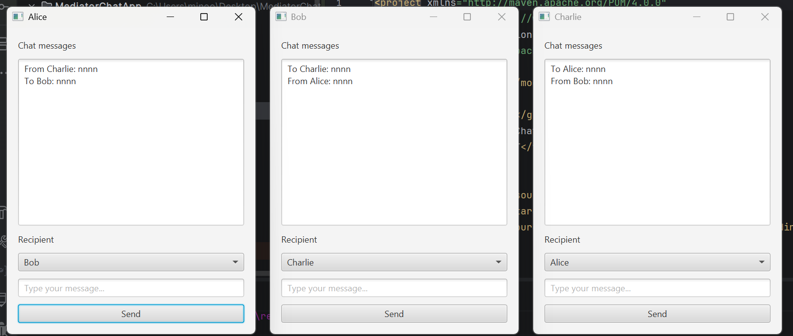

# Mediator Chat App

This is my Java assignment for the Mediator design pattern.

## About the project

I created a simple chat application using JavaFX. The application has three users: Alice, Bob and Charlie.

Each user has a separate chat window and can send messages to other users.

## What I implemented

- Mediator interface for communication.
- ChatRoom class to manage and deliver messages.
- A separate controller for each client.
- Three chat windows using JavaFX.
- Recipient selection and message input.
- Sending and receiving messages in real time.

## Mediator Pattern

The clients do not communicate directly with each other. All messages go through the ChatRoom, which acts as the mediator.

I also separated the user interface from the application logic.

## How to run

Open the project in IntelliJ IDEA and run this command in the terminal:

```bash
mvn javafx:run
```

Three chat windows will open. Select a recipient, type a message and click Send.

## Program Screenshot



## What I learned

In this assignment, I learned how the Mediator pattern works and how it helps reduce dependencies between objects.

I also practiced using JavaFX, Maven and separating the GUI from the application logic.

The application runs locally without additional threads or network connections.
